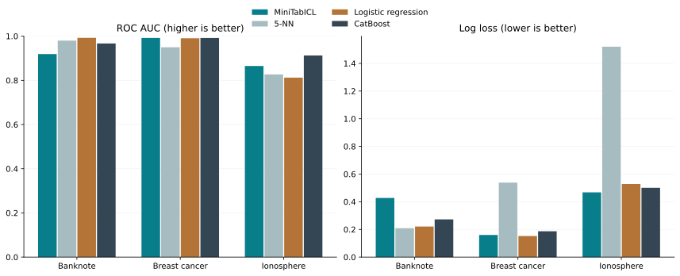
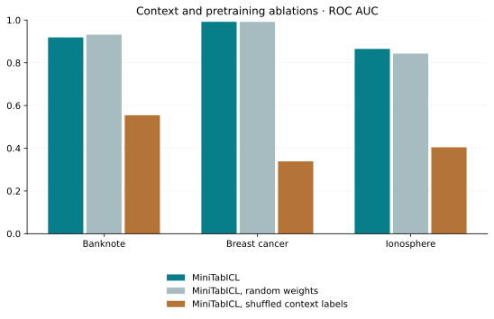

# Tabular in-context learning, built from scratch

**Independent research project · binary classification · PyTorch · inspired by ICML 2025 TabICL**

Can a single model learn from a new table **without updating its weights**? This project builds a small in-context learner that first practices on synthetic classification tasks and then uses labeled rows of an unseen real table as context. It compares with Logistic Regression and CatBoost trained on exactly the same 32 labeled rows.

The research inspiration is [Qu et al., *TabICL: A Tabular Foundation Model for In-Context Learning on Large Data* (ICML 2025)](https://proceedings.mlr.press/v267/qu25d.html). The original system was pretrained at a very different scale and supports much larger datasets. **This code and its weights are an independent CPU-scale experiment, not the official TabICL model and not a paper reproduction.**

## What I implemented

- A generator of synthetic tabular tasks with linear, interacting, radial, and periodic class boundaries ([prior.py](prior.py)).
- A three-stage PyTorch network: attention within each feature column, within each row, and across labeled context rows and hidden-label query rows ([miniicl.py](miniicl.py)).
- A learned local attention path over similar context examples. I added this inductive bias because short CPU pretraining alone was insufficient; it is **my design choice**, not a component claimed from the paper.
- Strict masking so no query label enters a forward pass, and no query can read a different query.
- A frozen-weight evaluation on three real [UCI](https://archive.ics.uci.edu/) classification datasets, with equal context and test rows for every method, train-only preprocessing, three seeds, and ablations for random weights and shuffled context labels ([benchmark.py](benchmark.py)).

For a step-by-step explanation in Russian, read [METHOD_RU.md](METHOD_RU.md).

## Evaluation design

| Dataset | Task | Rows | Original features | Source |
| --- | --- | ---: | ---: | --- |
| Banknote Authentication | Identify genuine versus forged notes | 1,372 | 4 | [UCI ID 267](https://archive.ics.uci.edu/dataset/267/banknote+authentication) |
| Breast Cancer Wisconsin (Original) | Benign versus malignant | 699 | 9 | [UCI ID 15](https://archive.ics.uci.edu/dataset/15/breast+cancer+wisconsin+original) |
| Ionosphere | Good versus bad radar return | 351 | 34 | [UCI ID 52](https://archive.ics.uci.edu/dataset/52/ionosphere) |

For each seed (42, 123, 2024), a stratified 75/25 split creates a training pool and held-out test set. Exactly **32 labeled context rows** come from the pool; the other pool rows are not used. At most 100 test rows are evaluated. Missing-value imputation, selection of up to 10 features, and scaling use the 32 context rows only. Ionosphere's 34 features are reduced to 10 for every method. The pretrained network receives the context features and labels and each test feature row; its weights stay frozen. Logistic Regression and CatBoost fit on the same context.

The shuffled-context diagnostic preserves the class counts but mismatches context features and labels. A random-weight version tests whether pretraining adds value beyond the local-attention path. Comparisons also include 5-nearest-neighbors (5-NN). **AUC** and accuracy are higher-is-better; log loss and Brier score are lower-is-better. Log loss and Brier score evaluate the probabilities themselves.

## Results

The benchmark numbers below come from completed local runs, averaged over three splits. The [per-split records](results/verified/metrics.csv), [aggregated values](results/verified/summary.csv), [pretraining manifest](results/verified/training_manifest.json), and [benchmark manifest](results/verified/run.json) are included so the claims can be checked.

| Dataset | MiniTabICL AUC | Logistic AUC | 5-NN AUC | CatBoost AUC | MiniTabICL log loss | Random-weight log loss |
| --- | ---: | ---: | ---: | ---: | ---: | ---: |
| Banknote | 0.919 | **0.992** | 0.980 | 0.967 | 0.427 | 0.486 |
| Breast cancer | 0.992 | 0.990 | 0.950 | 0.992 | 0.160 | 0.238 |
| Ionosphere | 0.865 | 0.812 | 0.827 | **0.913** | 0.468 | 0.652 |





The pretrained model's log loss was lower than the same architecture with random weights on **all three datasets**. Its AUC improved on Breast Cancer and Ionosphere but slipped from **0.932 to 0.919** on Banknote. Shuffling the context labels reduced mean AUC from **0.919 to 0.555**, **0.992 to 0.338**, and **0.865 to 0.404** respectively: the network is using the relation between features and labels. This diagnostic is not a substitute for comparison with strong baselines. Logistic Regression leads on Banknote AUC; CatBoost leads on Ionosphere AUC; the Breast Cancer AUC values for MiniTabICL and CatBoost round to the same three decimals. These tiny differences across only three splits do not establish a winner.

5-NN achieved low log loss on Banknote but a high log loss on Ionosphere (mean **1.521**); near-zero or near-one probabilities are penalized sharply when wrong. The complete log loss, Brier score, accuracy, per-seed results and timings are in the linked files.

## Reproduce

Python 3.10+ and a CPU are sufficient. From the repository root, on Windows PowerShell:

```powershell
python -m venv .venv
.venv\Scripts\python -m pip install -r requirements.txt
.venv\Scripts\python -m unittest discover -s tests -v
.venv\Scripts\python benchmark.py --context 32 --max-test 100 --features 10 --threads 4
```

The repository includes the small [pretrained checkpoint](artifacts/model.pt), so the benchmark can run immediately after dependencies and UCI data download. To reproduce its pretraining from a random initialization, run:

```powershell
.venv\Scripts\python train.py --steps 1200 --batch-size 16 --context 32 --query 8 --threads 4
.venv\Scripts\python benchmark.py --context 32 --max-test 100 --features 10 --threads 4
```

For macOS/Linux, replace `.venv\Scripts\python` with `.venv/bin/python`. On a CPU-only Linux machine, install the CPU PyTorch wheel before `requirements.txt` with `.venv/bin/python -m pip install torch==2.10.0 --index-url https://download.pytorch.org/whl/cpu` to avoid downloading CUDA packages ([official PyTorch instructions](https://pytorch.org/get-started/locally/)). The three UCI datasets download on first use, requiring internet access. Their raw copies go under ignored `.cache/data/`. New checkpoints other than the published `artifacts/model.pt` and raw results under `results/raw/` are ignored by Git. The exact completed run is frozen in `results/verified/`. To regenerate the figures from those records, use `python plot_results.py`. CPU training took about **115 seconds** on the measured machine, excluding Python startup.

The benchmark does **not** download the authors' pretrained checkpoint. The entire compact model is trained by `train.py` from a random initialization. A small two-step training check and the unit tests also run automatically on GitHub Actions after each push.

## Limits

- Three small datasets and three random splits are a portfolio experiment, not a broad benchmark or a statistical superiority claim.
- The synthetic pretraining prior is much simpler than the official TabICL prior. Architecture, training budget, context length, and feature limit differ substantially from the paper.
- Binary targets and numeric features only. Missing values are imputed and high-dimensional tables are reduced to 10 selected features.
- On Ionosphere, selecting features from only 32 labels can be unstable. The same selection is used for all methods.
- Training time for CatBoost and Logistic Regression is included in their measured wall time; the in-context model's time covers prediction after its separate pretraining. Compare these timings with that distinction in mind.
- Raw UCI data are not committed. The small checkpoint was generated by this repository's training script and is included for immediate evaluation; load only checkpoints you trust. Dataset pages identify their CC BY 4.0 licenses; this repository's original code is MIT licensed.

Built by [@y4rik2009-bit](https://github.com/y4rik2009-bit). Research inspiration: [TabICL paper](https://proceedings.mlr.press/v267/qu25d.html) and [official code](https://github.com/soda-inria/tabicl).
